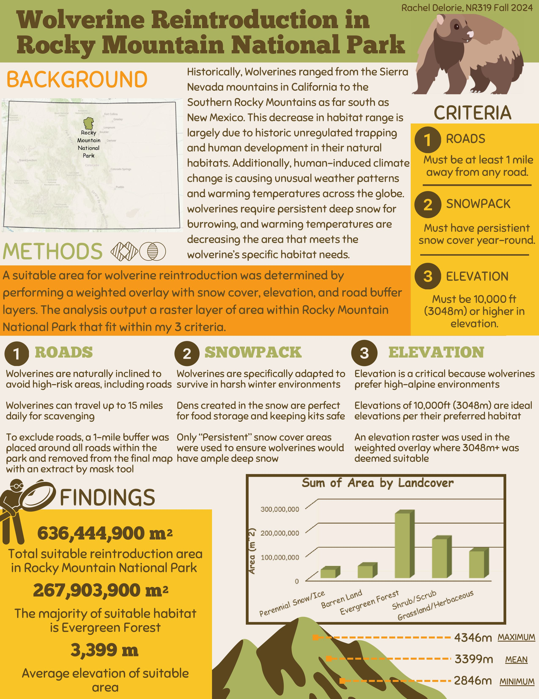
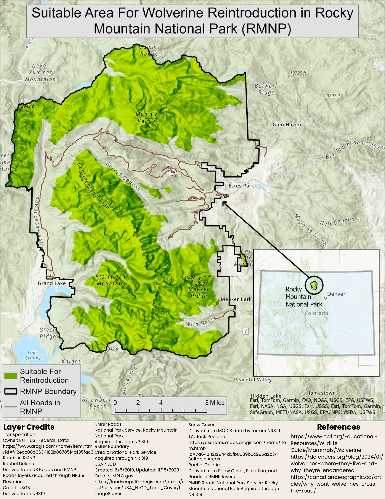

### Raptor Suitability

The following is a final report from NR 450, Geospatial Project Design and Analysis. In this course, my project partner and I designed and implemented a geospatial project from conception to completion. We produced an experience builder page, report, and presentation to effectively communicate project findings to technical and non-technical audiences.

##### Final Report

{fig-align="center"}

##### Experience Builder Page

<https://experience.arcgis.com/experience/c594f76f615a4569b2d09dbe821c5206>

### Wolverine Reintroduction Analysis

The following layout was created for my final project in NR 319, Introduction to Geospatial Sciences for Natural Resources, in the Fall of 2024. The goal of the project was to practice all of the GIS skill acquired throughout the course, including spatial analysis, cartography, and real-world application of spatial data.

{width="445"}

{width="448"}

## World Travel

When given the opportunity to "choose my own geospatial adventure" in NR 493, Seminar on GIS and Remote Sensing Applications, I decided to fine tune my cartography skills and create a product that is both informational and visually appealing. I collected the data, years and places my grandmother has traveled, then joined it to a world countries polygons layer. I then used creative style packages and techniques from John Nelson, Esri cartographer, to create the following. I will be collecting feedback and improving this map Fall 2025.

