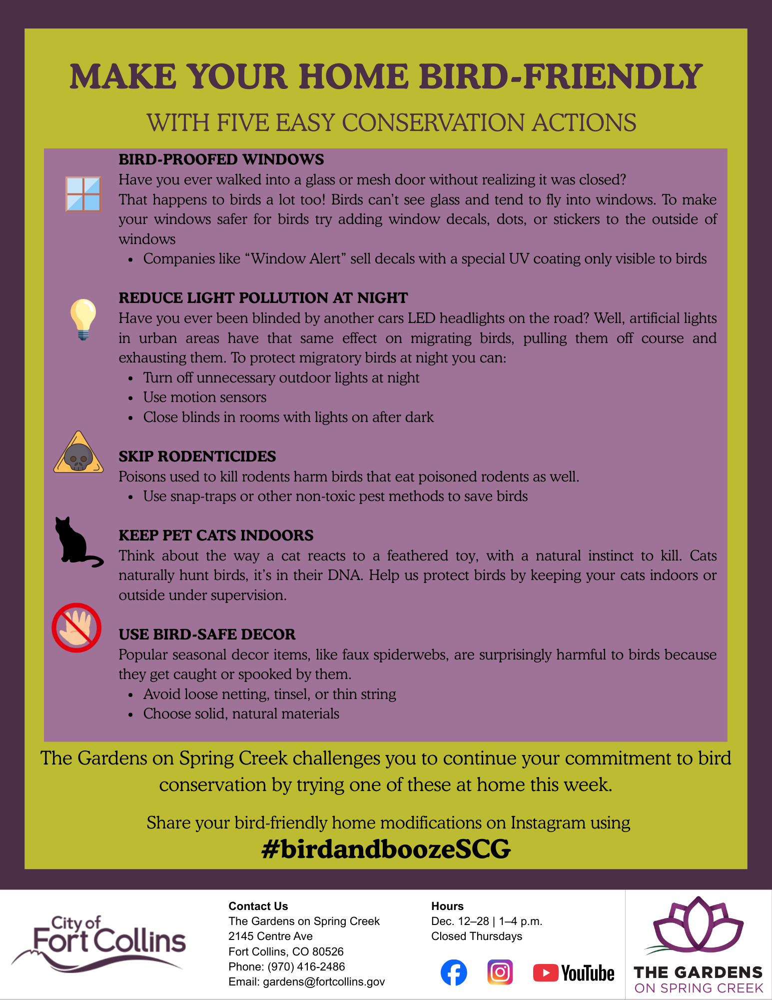

## Life Cycle Impact Assessment

In ESS 555 - Life Cycle Analysis, I compared the impacts of artificial turf to natural grass lawns. This study uses comparative LCIA methodology as per ISO 14040 guidelines to evaluate cradle-to-gate environmental impacts of both turf materials.

## Practicing Sustainability

In my capstone course, Practicing Sustainability, I collaborated with 5 classmates to develop a list of wise practices for the Appalachian Rekindling Project as they plan a bison reintroduction in Eastern Kentucky.

## Public Communications and Outreach

{fig-align="left" width="439"}

{fig-align="left"}

## Qualitative Research

Below is "Perceived Environmental Responsibility: How Undergraduate Students’ Educational and Social Background Influences Their Role in Addressing Sustainability Challenges". This mixed methods research report was created for ESS 312, Sustainability Science.

## Course Development

I have created content to two masters-level courses for a developing program in the Natural Resources Recreation and Tourism department at Colorado State University. Thank you to Dr. Stu Cottrell for the opportunity to contribute to this.

{width="762"}

{width="883"}

### Science and Democracy

The following is a proposal created in CO 301B, Writing in the Sciences, to argue for the Way Cup initative created by Wolverine Farm Publick House to be implemented across all coffee shops in the City of Fort Collins.

